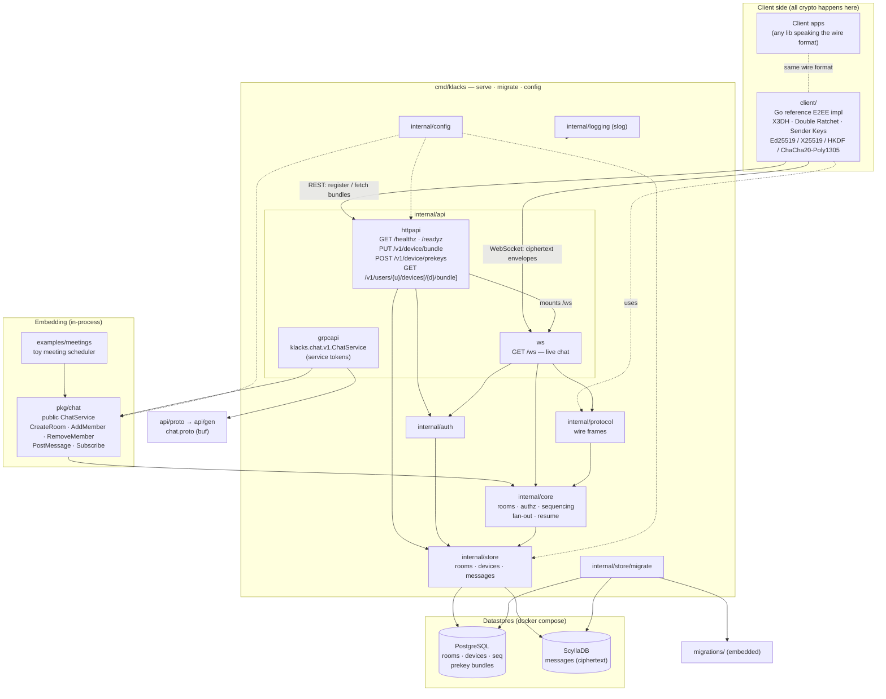

# Architecture

How the pieces of klacks fit together. Arrows are real package imports or
network calls; dotted arrows are configuration, logging or "speaks the same
format".

- **The server never sees plaintext.** Only `client/` (and real client apps)
  encrypt and decrypt. The server stores and relays ciphertext. Both sides
  speak the [klacks wire protocol](protocol.md).
- **Three ways in.** Over the network, clients use `httpapi` for prekey
  bundles and `ws` for messages. Embedders call `pkg/chat` in-process, or
  its gRPC mirror (`grpcapi`) from another process. All paths end in
  `internal/core`.
- **Split storage.** PostgreSQL holds rooms, devices, sequence numbers and
  prekey bundles. ScyllaDB holds messages.
- **One core, two transports.** With `grpc.addr` set, `serve` runs the gRPC
  API next to HTTP over the same core: its fan-out and member removals reach
  both the WebSocket hub and the gRPC subscriptions, so each transport sees
  the other's messages live.

Test-only packages (`internal/testutil/dbtest`) are left out.
